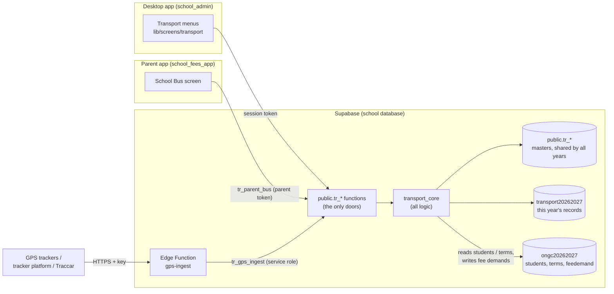
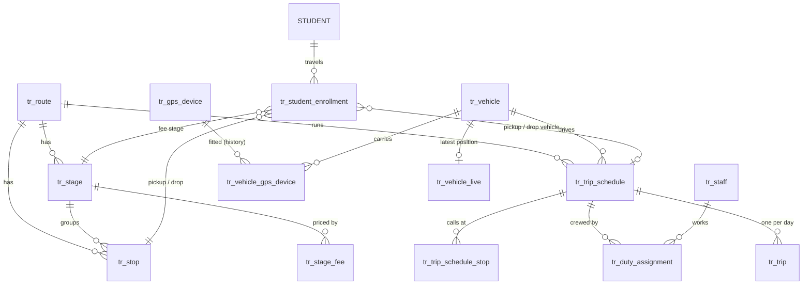
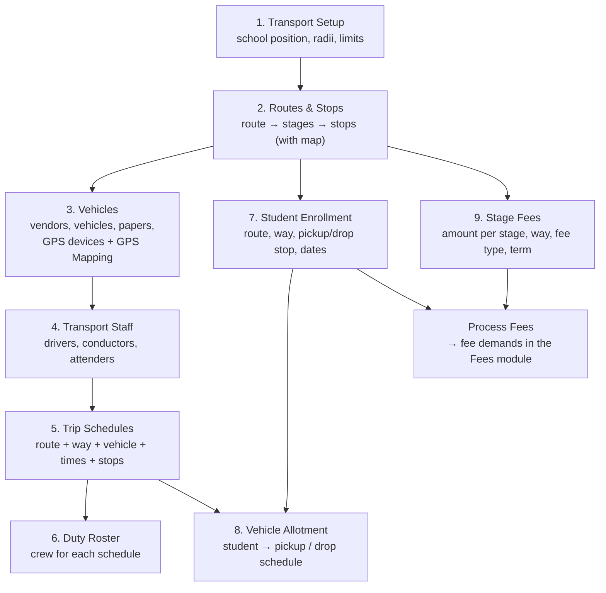

# Transport Module: Design and Workflow

FIT School: desktop admin app, school database (Supabase) and parent mobile app.
State as of 2026-11-20.

This document explains how the transport module is built, how its data fits together, and the order things happen in, from setting up routes to a parent watching the bus on a map. Database file rules and install steps are in [`migrations/desktop/TRANSPORT_DB_README.md`](../migrations/desktop/TRANSPORT_DB_README.md).

---

## 1. What the module does

| Who | What they get |
|---|---|
| School admin (desktop app) | Routes, stages and stops; vehicles, vendors, documents, service, fuel and GPS devices; transport staff; trip schedules and duty roster; which students travel, where they board and which vehicle they ride; stage fees and the process that bills them. |
| Fees module | Transport fees become ordinary fee demands (`feedemand`), collected and receipted like any other fee. |
| Parents (mobile app) | A **School Bus** screen: the child's route, stops and the bus's live position on a map. |
| GPS trackers | A web address (`gps-ingest`) that receives the buses' positions. |

The module is switched on per school in **Module Control** (module code `TRN`, vendor only). When it's off, the Transport menu is hidden and parents see "School transport is not available".

---

## 2. Architecture



**Principles**

- **Tables are closed to the app.** Every transport table has row-level security on and no grants to `anon` / `authenticated`. Both apps reach the data only through the `public.tr_*` functions, which run as owner and check the session first.
- **Code lives apart from data.** All logic is in the `transport_core` schema, so it isn't copied into each year and survives an old year being dropped.
- **Masters vs. year records.** Things that last across years (routes, stops, vehicles, staff, GPS devices) live in `public`. Things that belong to one academic year (fees, schedules, enrolments, trips, GPS pings) live in that year's schema.
- **Menu names are the permission keys.** Each record type is tied to a desktop menu (for example `Routes & Stops`, `Stage Fees`), and a role may use it only if Setup → Roles & Access gives it that menu.

---

## 3. Data model

### 3.1 Schemas

| Schema | Holds | Example |
|---|---|---|
| `public` | Transport masters (`tr_*`), shared by every year | `public.tr_route` |
| `transport<yyyy><yyyy>` | One schema per academic year, named like the school app's `ongc20262027` | `transport20262027` |
| `transport_core` | All transport functions; no data | `transport_core.parent_bus` |
| `<school><yyyy><yyyy>` | The school app's year schema; transport reads students and terms from it and writes fee demands to it | `ongc20262027` |

`transport_core.year_schema('2026-2027')` gives `transport20262027`. A 2-digit end year works too: `2026-27` gives 2027.

### 3.2 Masters (`public`)

| Table | What it is |
|---|---|
| `tr_settings` | Per-school transport settings (Transport Setup). |
| `tr_route` | A route: code, name, start/end point, distance, duration. |
| `tr_stage` | A fee stage of a route: number, name, km range. |
| `tr_stop` | A pickup stop: route, stage, pickup order (`stop_seq`), name, code, landmark, latitude/longitude, arrival radius. |
| `tr_vendor` | A transport vendor (hired vehicles or staff). |
| `tr_vehicle` | A vehicle: code, registration, type, fuel, seats + `additional_capacity` (small children beyond the seats), ownership, current GPS device. |
| `tr_vehicle_document` | Vehicle papers (insurance, FC, permit, …) with expiry dates. |
| `tr_vehicle_service` | Service and repair records, each with its academic year. |
| `tr_gps_device` | A GPS tracker: IMEI (unique), SIM, vendor, protocol. |
| `tr_vehicle_gps_device` | History of which tracker was on which vehicle, and from/to when (GPS Mapping). |
| `tr_staff` | Drivers, conductors and attenders: licence and its validity, photo, vendor. |
| `tr_staff_document` | Staff documents with expiry. |

### 3.3 Year records (`transport20262027`)

| Table | What it is |
|---|---|
| `tr_stage_fee` | The fee for a route + stage + way (Both / Pickup / Drop) + fee type + term, from a start date. |
| `tr_stage_fee_demand` | Every fee demand the Stage Fee Process made or updated (an audit trail). |
| `tr_trip_schedule` | A regular run: route, direction (Pickup / Drop), vehicle, planned start/end, weekdays (ISO 1 = Monday), valid dates. |
| `tr_trip_schedule_stop` | The schedule's stops with planned times and halt minutes. |
| `tr_duty_assignment` | Who drives or attends a schedule (Driver, Conductor, Attender), from a date, optionally to a date. |
| `tr_student_enrollment` | A student's transport: route, way, pickup and drop stops, **fee stage**, pickup and drop schedules (vehicle allotment), start/end dates, status (Active, Suspended, Cancelled, Completed). |
| `tr_trip` | One day's run of a schedule (made by the daily trip generator): status, vehicle, actual times, last GPS position, next stop. |
| `tr_trip_stop`, `tr_trip_student`, `tr_trip_staff` | That day's stops, expected students and crew. |
| `tr_gps_ping` | Every GPS position received (partitioned by month, with a default partition). |
| `tr_vehicle_live` | The latest position of each vehicle (what the parents' map reads). |
| `tr_fuel_log` | Fuel fills. |
| `tr_notification_template`, `tr_notification_log`, `tr_notify_contact` | Parent alerts (for example "bus arriving in 10 minutes"). |
| `tr_staff_leave`, `tr_student_trip_exception`, `tr_trip_event` | Leave, one-day changes for a student, trip events. |

Report views: `v_schedule_occupancy` (seats used per schedule), `v_fee_demand` (students per stage), `v_document_expiry`, `v_trip_summary`, `v_stop_punctuality`, `v_vehicle_monthly`.

### 3.4 How the main records connect



`STUDENT` is the school app's `ongc20262027.students` (`stu_id`). The fee stage of an enrolment is the stage of the **farther** of its two stops.

---

## 4. Access and security

| Door (function) | Called by | Checks |
|---|---|---|
| `tr_list`, `tr_save`, `tr_delete` (one per record type), `tr_settings_get` / `tr_settings_save`, `tr_lookups`, `tr_students`, `tr_stage_fee_routes`, `tr_stage_fee_process` | Desktop app, with the staff session token | `session_context` (signed in, not deactivated, school active) and `_role_can` (the role has the record type's menu). Parents are refused. |
| `tr_parent_bus(token, stu_id)` | Parent app | A **parent** session (`app_session.par_id`) and the child must be the parent's (`parentdetail`). |
| `tr_gps_ingest(positions)` | `gps-ingest` Edge Function only | Granted to `service_role` only; the apps can't call it. |

Every row is scoped to the session's school (`inst_id`). A record from another school is "not found".

---

## 5. Desktop screens

All are under the sidebar's **Transport** section (school only, Admin roles by default).

| Menu | What the admin does | Main data |
|---|---|---|
| **Transport Setup** | School location; arrival radius for the school and the stops; overspeed limit; long-halt minutes; GPS update interval; whether trips start automatically from GPS; days of warning before documents expire. | `tr_settings` |
| **Routes & Stops** | Routes, then their stages, then their pickup stops in order. Each stop shows how many students get on or off there. The stop form has a **map**: click to place the stop, or search a place by name (OpenStreetMap search, no key), or paste coordinates or a Google Maps link. | `tr_route`, `tr_stage`, `tr_stop` |
| **Vehicles** | Tabs: Vehicles (with Documents), Vendors, Service, Fuel, GPS Devices, GPS Mapping (which tracker is on which vehicle from which date). | `tr_vehicle*`, `tr_vendor`, `tr_gps_device`, `tr_fuel_log` |
| **Transport Staff** | Drivers, conductors and attenders, with licence, photo and documents. | `tr_staff`, `tr_staff_document` |
| **Trip Schedules** | Regular runs: route, Pickup or Drop, vehicle, times, weekdays, and the stops with planned times. | `tr_trip_schedule(_stop)` |
| **Duty Roster** | Who works each schedule, and from when. | `tr_duty_assignment` |
| **Student Enrollment** | For one route: which students travel, the way (Both / Pickup / Drop), pickup and drop stops (drag a stop onto a student), start and end dates, status. Saved as one batch. | `tr_student_enrollment` |
| **Vehicle Allotment** | For one route: which schedule (vehicle) each student rides, by drag and drop. Capacity is seats + additional. | `tr_student_enrollment.pickup/drop_schedule_id` |
| **Stage Fees** | For a term and fee type: the amount of each stage. Then **Process Fees** bills the students. | `tr_stage_fee`, `feedemand` |

---

## 6. Setup workflow (in order)



1. **Transport Setup.** Enter the school's position and the default limits once.
2. **Routes & Stops.** Create each route, its fee stages (Stage 1, 2, … with km ranges), and its stops in pickup order. Each stop belongs to one stage and has a position; click the map in the stop form to place it.
3. **Vehicles.** Add vendors (for hired vehicles), vehicles with their papers, and each GPS tracker by IMEI. Then in **GPS Mapping**, fit each tracker to its vehicle from a date. A tracker moved to another bus keeps its history.
4. **Transport Staff.** Add drivers and attenders, with licence details.
5. **Trip Schedules.** For each route, a Pickup schedule (morning) and a Drop schedule (evening): vehicle, times, weekdays, and the stops it calls at with planned times.
6. **Duty Roster.** Assign the driver (and conductor or attender) to each schedule from a date.
7. **Student Enrollment.** Pick a route and add its students, each with a way (Both / Pickup / Drop), a pickup and/or drop stop, and a start date. The **fee stage** is set automatically from the farther stop. A student who stops using transport is set to Cancelled or given an end date; enrolments are never deleted.
8. **Vehicle Allotment.** For the route, drag each student onto the pickup and drop schedule (that is, the vehicle) they ride. Capacity checks use seats + additional capacity.
9. **Stage Fees → Process Fees.** See section 7.

---

## 7. Fees: from stage fee to fee demand

A **stage fee** is the amount for one route + stage + way (Both / Pickup / Drop), for one fee type (the transport fee head in `feetype`) and one term (`semester` of the year), from a start date.

**Process Fees** (Stage Fees screen) runs for a term + fee type over the ticked routes. For every student whose transport is active on those routes and runs in that term:

1. **Find the amount.** It's the stage fee of the student's fee stage and way, for that term and fee type; the latest start date wins.
2. **Find the due date.** It comes from the student's class fee for that term and fee type in the Fee Master (`classfeedemand`). Without one, the student is left out with a message.
3. **Write the demand.** The student's fee demand for that term and fee type (not an arrear) takes the stage fee as its amount, or a new REGULAR demand is made. The balance is the amount less concession and paid.
4. **Never below what's paid.** An amount lower than paid + concession is refused for that student, who keeps the demand as it was.
5. **Keep a record.** Every demand made or updated is recorded in `tr_stage_fee_demand`.

A student who is refused doesn't stop the others. Running it again is safe: new students are added, changed fees are updated, and the rest are left alone. From then on the transport fee is collected, receipted and reported like any other fee.

---

## 8. Daily operation

### 8.1 Trips

`transport_core.fn_generate_trips(school, date)` turns the schedules that run on that weekday into that day's `tr_trip` rows, with their stops, expected students and crew. **Nothing runs it automatically yet** (see section 11).

### 8.2 Live bus position (GPS)

```mermaid
sequenceDiagram
  participant T as Tracker / platform
  participant EF as gps-ingest (Edge Function)
  participant DB as tr_gps_ingest → gps_ingest
  participant P as Parent app
  T->>EF: position (IMEI, lat, lon, time, speed…) + key
  EF->>EF: check key, read the format
  EF->>DB: positions (service role)
  DB->>DB: IMEI → device → vehicle that day → year
  DB->>DB: store ping; update tr_vehicle_live if newer;<br/>update today's trip in progress
  loop every 20 s while the screen is open
    P->>DB: tr_parent_bus(token, child)
    DB-->>P: route, stops, trips, vehicle, live position
  end
```

- **Address:** `https://<project>.supabase.co/functions/v1/gps-ingest?key=<GPS_INGEST_KEY>`.
- **Formats accepted:** OsmAnd / Traccar Client URL parameters (speed in knots), Traccar position-forwarding JSON, Traccar Client JSON, or simple JSON (`imei`, `lat`, `lon`, `time`, `speed_kmph`, …). One position or a list.
- **Skipped positions:** the reply names the reason for each one: unknown or switched-off device, device on no vehicle, 0 / 0 or out-of-range position, device clock more than 10 minutes ahead, or older than 7 days.
- **TCP trackers:** trackers that speak TCP (GT06 / Concox, Teltonika) need a Traccar server to forward to this address.
- **Setup and deployment:** [`supabase/functions/gps-ingest/README.md`](../supabase/functions/gps-ingest/README.md).

### 8.3 What parents see (School Bus screen)

- **When it shows:** the home screen shows a School Bus card, and the desktop/web sidebar has a School Bus entry, only for a child with active transport.
- **The map:** OpenStreetMap, no API key. It shows the route line through the stops in pickup order, the child's stop as a gold pin, and the bus as a teal marker (grey when not live).
- **The trips:** Pickup and Drop, each with its times, today's state (on the way, done, cancelled, no trip today), the vehicle, the next stop and the child's stop.
- **Which trip shows first:** the morning trip before noon, the drop trip after.
- **Live:** a position counts as live for 10 minutes; after that it says "Last seen … ago".
- **Refresh:** every 20 seconds while the screen is open.
- **No Google Maps key:** there's no Google Maps key anywhere in the mobile app.

---

## 9. Academic year

- **Masters carry over:** they stay in `public` and are shared, so routes, stops, vehicles and staff carry over automatically.
- **Each year gets its own schema.** When the school app starts a new year (Year End or a new year registration), `public.school_transport_year` (called from `school_read_lock_new_schema`) runs `transport_core.create_year_schema('2027-2028')`. That:
  - copies the **structure** of the latest year schema with **no rows**,
  - continues IDs from the old year, so they never repeat,
  - links the new year's stage fees to that year's terms.
- **Fees and schedules start fresh.** Stage fees, schedules, enrolments and allotments are entered again for the new year.
- **Monthly GPS partitions** are optional: `fn_create_ping_partition(schema, month)`. Without them, pings go to the default partition.

---

## 10. Settings stored for later features

Transport Setup stores these, but no logic uses them yet:
- ETA alert minutes,
- arrival radii (geofence),
- overspeed limit,
- long-halt minutes,
- GPS interval,
- "start trips automatically",
- SMS / WhatsApp / push options.

They are ready for the features in section 11.

---

## 11. Not built yet

| Item | State |
|---|---|
| Daily trip generation | `fn_generate_trips` exists; nothing runs it each day (it needs a scheduled job). Until then trips have no status and parents see "today" instead of "on the way". |
| Trip start/end from GPS, arrivals at stops, overspeed and long-halt events | Settings and `tr_trip_event` exist; no logic writes them. |
| Parent alerts (bus arriving) | `fn_queue_eta_alerts` can queue messages into `tr_notification_log`; no sender (SMS / WhatsApp / push) and no template screen. |
| Notify contacts, staff leave, one-day student changes | Tables only; no screen. |
| GPS trackers on live | The receiver is deployed and its key set on live. Trackers must be added (IMEI), mapped to vehicles and pointed at the address. TCP trackers need a Traccar server. |
| Route A1 stop positions | Its 10 stops still hold a 90 / 90 placeholder; place them with the stop map. |

---

## 12. Where things live

| Part | Location |
|---|---|
| Desktop screens | `lib/screens/transport/` (one file per menu; `transport_master_panel.dart` is the shared list + form; `stop_map_picker.dart` is the stop map) |
| Desktop data access | `lib/services/transport_service.dart` |
| Database files | `migrations/desktop/transport_01 … transport_22*.sql`, run order in `transport_install_order.txt`, rules in `TRANSPORT_DB_README.md`, one-file scripts in `single/` |
| Database tests | `migrations/desktop/transport_02_phase1_tests.sql` (342 checks, always rolled back) |
| School setup script | `C:\pg_backups\school_complete_setup.sql`, part 86 (module) and part 87 (new-year hook) |
| GPS receiver | `supabase/functions/gps-ingest/` and `supabase/functions/_shared/gps_formats.ts` |
| Parent app | `ongc mobile app`: `lib/presentation/screens/transport/bus_screen.dart`, `lib/presentation/providers/bus_provider.dart`, `lib/data/models/bus_info_model.dart` |
